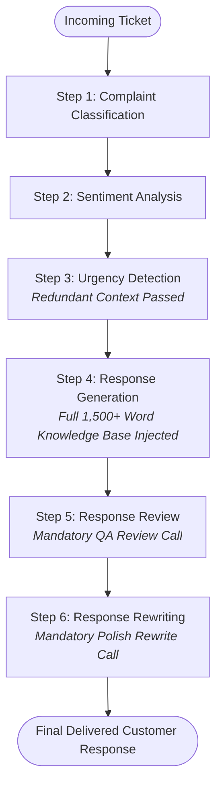

# Deliberately Inefficient AI Customer Support Workflow

A simple, fully functional AI customer support workflow built with **Python**, **LangChain**, and **Ollama** (`lfm2.5:8b`), instrumented with **Neatlogs** and local execution logging.

> **Purpose & Context:**  
> This workflow acts as an intentional baseline testing environment for an **AI FinOps Agent**. It genuinely executes real LLM calls and exposes measurable token usage, latency, and costs. The workflow deliberately embodies common anti-patterns and structural inefficiencies that will later be analyzed and optimized.

---

## Architecture & Six-Step Sequential Workflow

Every customer support ticket passes through **six sequential LLM calls**:



1. **Step 1: Complaint Classification**  
   Classifies the incoming message into `shipping`, `refunds`, `payments`, or `product issues`.
2. **Step 2: Sentiment Analysis**  
   Evaluates customer sentiment as `positive`, `neutral`, `frustrated`, or `angry` in an isolated LLM invocation.
3. **Step 3: Urgency Detection**  
   Evaluates urgency (`Low`, `Medium`, `High`) by deliberately repeating previous classification and sentiment context into the prompt.
4. **Step 4: Response Generation**  
   Drafts a support response by injecting the customer ticket, accumulated metadata, mock order details, and the **entire DemoShop policy manual** (~1,500+ words) directly into the prompt without RAG or selective retrieval.
5. **Step 5: Response Review**  
   A dedicated QA supervisor call critiques the draft for tone, policy compliance, and accuracy.
6. **Step 6: Response Rewriting**  
   A final LLM call rewrites the draft into the final customer-facing response based on the supervisor's feedback.

---

## Intentional Inefficiencies for FinOps Benchmarking

The workflow purposefully preserves six core inefficiencies for cost and latency profiling:

| # | Inefficiency | Description | Target FinOps Optimization |
|---|---|---|---|
| 1 | **Sequential Calls** | 6 separate LLM round-trips for one ticket. | Prompt consolidation / multi-task extraction |
| 2 | **Uniform Large Model** | Massive model (`lfm2.5:8b` or `gpt-4o`) used even for 1-token classification. | Model routing (SLMs for classification/sentiment) |
| 3 | **Redundant Context** | Re-passing previous outputs across intermediate prompts. | Context minimization |
| 4 | **Uncompressed Knowledge Base** | Full policy manual injected into Step 4 prompt. | Semantic RAG / chunk retrieval |
| 5 | **Obligatory Review & Rewrite** | Always executes Steps 5 & 6 regardless of draft quality. | Conditional evaluation / single-pass generation |
| 6 | **Zero Caching & Batching** | Every execution starts cold without response or prompt caching. | Semantic caching & prompt prefix caching |

---

## Tech Stack

- **Python 3.11+**
- **LangChain** (Current LCEL APIs: `PromptTemplate`, `ChatPromptTemplate`, `StrOutputParser`)
- **Ollama** (`lfm2.5:8b` locally installed) or **OpenAI** (`gpt-4o`)
- **Neatlogs** for cloud-native telemetry export
- **JSON / JSONL** for local audit logs (`logs/workflow_runs.jsonl`)
- **uv** for fast package and virtual environment management

---

## Project Structure

```
workflow/
├── .venv/                      # Python virtual environment (uv)
├── main.py                     # CLI entry point (--demo, --ticket, etc.)
├── workflow.py                 # 6-step sequential LangChain workflow
├── prompts.py                  # Prompt templates with intentional inefficiencies
├── mock_data.py                # DemoShop policies, orders (#12345, etc.), tickets
├── observability.py            # Neatlogs handler & local JSONL metrics tracker
├── requirements.txt            # Python package dependencies
├── .env.example                # Environment variables template
├── .env                        # Active local environment configuration
├── README.md                   # Documentation and usage guide
└── logs/                       # Generated JSONL and JSON execution logs
```

---

## Installation & Setup

1. **Ensure Ollama is running** with `lfm2.5:8b`:
   ```bash
   ollama list
   # Verify lfm2.5:8b is available
   ```

2. **Navigate to the workflow directory and manage dependencies using `uv`**:
   ```bash
   cd workflow
   uv venv .venv
   uv pip install -r requirements.txt --python ./.venv/Scripts/python.exe
   ```

3. **Configure Environment Variables**:
   Copy `.env.example` to `.env` inside `workflow/` if not already present:
   ```bash
   cp .env.example .env
   ```
   Default `.env` configuration:
   ```ini
   LLM_PROVIDER=ollama
   OLLAMA_MODEL=lfm2.5:8b
   OLLAMA_BASE_URL=http://localhost:11434

   NEATLOGS_API_KEY=qlandigNwgrvCTBGuLb2xRIpRQQBtpTw
   NEATLOGS_ENDPOINT=https://ingest.neatlogs.com
   NEATLOGS_WORKFLOW_NAME=demo-workflow
   ```

---

## Running the Workflow

Navigate to `workflow`:

### 1. Run the Primary Demo Ticket
Runs Sample Ticket #1 (Delayed headphones with Order ID #12345):
```bash
python main.py --demo
```
*(Or simply run `python main.py`, which defaults to `--demo` to conserve tokens).*

### 2. Run a Custom Support Ticket
Pass any custom customer message:
```bash
python main.py --ticket "I ordered headphones 8 days ago, but they still haven't arrived. My order ID is #12345. Can you check the shipping status and tell me if I can get a refund?"
```

### 3. Run Specific Mock Tickets
Select from 5 diverse mock customer scenarios (1 to 5):
```bash
python main.py --ticket-id 2    # Crushed soundbar & damaged delivery
python main.py --ticket-id 3    # Duplicate order cancellation window
python main.py --ticket-id 4    # Double billing charge on credit card
python main.py --ticket-id 5    # 4K monitor flickering warranty claim
```

### 4. Override Model or Provider
Run using OpenAI (requires `OPENAI_API_KEY` in `.env`):
```bash
python main.py --demo --provider openai --model gpt-4o
```

---

## Observability & Audit Logs

Each execution captures **actual execution metrics** from LLM provider responses:
- **Neatlogs**: Automatically pushes spans to `https://ingest.neatlogs.com`.
- **Local Logs**:
  - `logs/workflow_runs.jsonl`: Append-only JSON Lines ledger containing full ticket details, per-step token counts, latencies, and output snippets.
  - `logs/run_<timestamp>_<ticket_id>.json`: Individual execution run snapshot.
